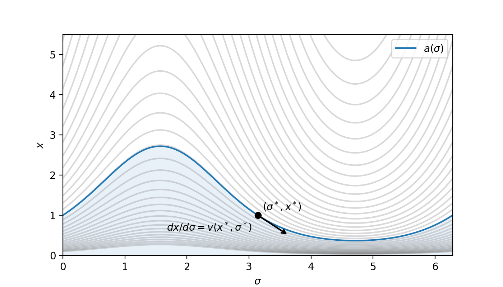

Assume the setup as in [ODE formulation](../README.md#ode-formulation).

We aim to show:

$$
\frac{\partial q}{\partial \sigma} = -\frac{\partial}{\partial x} (v q)
$$

Fix a point $`(\sigma^*, x^*)`$, and let $a(\sigma)$ be the trajectory of a sample passing through it, so that $`a(\sigma^*) = x^*`$ and $a'(\sigma) = v(a(\sigma), \sigma)$. This trajectory is fully determined by the ODE and the point. Therefore, different trajectories cannot cross. If they intersected at some point, following the velocity forwards and backwards would leave us on identical curves.

Let $X(\sigma)$ be the trajectory of a random sample. Since the trajectories never cross, if $X(\sigma)$ is at or below $a(\sigma)$ for some $\sigma$, it must be at or below $a(\sigma)$ for *all* $\sigma$.

Define $Q(x; \sigma) = \mathbb{P}(X(\sigma) \leq x)$. Then, $Q(a(\sigma); \sigma) = \mathbb{P}(X(\sigma) \leq a(\sigma))$ is constant in $\sigma$, so the trajectories are quantile curves.

Since $Q(a(\sigma); \sigma)$ is constant in $\sigma$, differentiating it using the multivariate chain rule gives:

$$
0 = \frac{d}{d\sigma} Q(a(\sigma); \sigma) = \left. \frac{\partial Q}{\partial x} \right|_{x = a(\sigma)} a'(\sigma) + \left. \frac{\partial Q}{\partial \sigma} \right|_{x = a(\sigma)}
$$

We have that:

$$
\frac{\partial Q}{\partial x} = \frac{\partial}{\partial x} \int_{-\infty}^x q(x'; \sigma) dx' = q(x; \sigma)
$$

and

$$
\frac{\partial Q}{\partial \sigma} = \frac{\partial}{\partial \sigma} \int_{-\infty}^x q(x'; \sigma) dx' = \int_{-\infty}^x \frac{\partial}{\partial \sigma} q(x'; \sigma) dx'
$$

Substituting these into the chain rule, and evaluating at $`\sigma = \sigma^*`$, where $`a(\sigma^*) = x^*`$ and $`a'(\sigma^*) = v(x^*, \sigma^*)`$:

$$
v(x^*, \sigma^*) q(x^*; \sigma^*) + \int_{-\infty}^{x^*} \frac{\partial}{\partial \sigma} q(x'; \sigma^*) dx' = 0
$$

Since $`(\sigma^*, x^*)`$ was arbitrary, this holds at every point $(\sigma, x)$:

$$
v(x, \sigma) q(x; \sigma) + \int_{-\infty}^{x} \frac{\partial}{\partial \sigma} q(x'; \sigma) dx' = 0
$$

Now, differentiate with respect to $x$:

$$
\frac{\partial}{\partial x} \left( v(x, \sigma) q(x; \sigma) \right) + \frac{\partial}{\partial \sigma} q(x; \sigma) = 0
$$

Rearranging this gives the result:

$$
\frac{\partial q}{\partial \sigma} = -\frac{\partial}{\partial x} (v q)
$$

