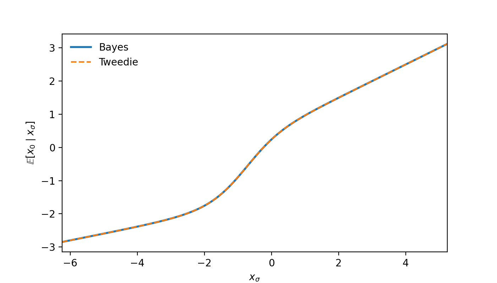
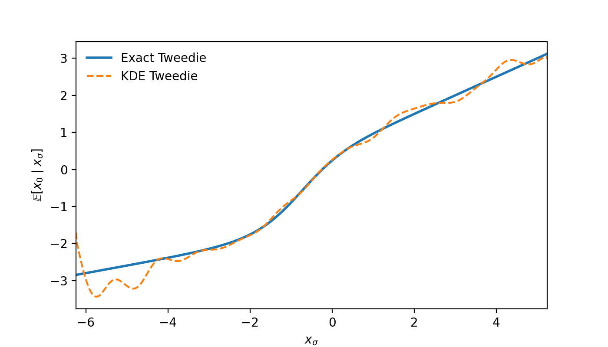

# Numerical verification

The following visually verifies 1-dimensional [Tweedie's formula](proofs/tweedies-formula-1d.md) for a Gaussian mixture prior:

$$
p_0(x_0) = 0.3 N(x_0; -2, 0.5^2) + 0.7 N(x_0; 1, 1^2)
$$

and $\sigma = 1$.

We calculate $\mathbb{E}[x_0 \mid x_\sigma]$ by direct calculation via Bayes' rule and by Tweedie's formula. Both methods give the same result:

We also show that we can apply KDE to 5000 samples of $x_\sigma$ to obtain estimates of $\mathbb{E}[x_0 \mid x_\sigma]$ that are close to those obtained with knowledge of the true prior predictive distribution.

Regenerate: `python scripts/verify_tweedie.py`